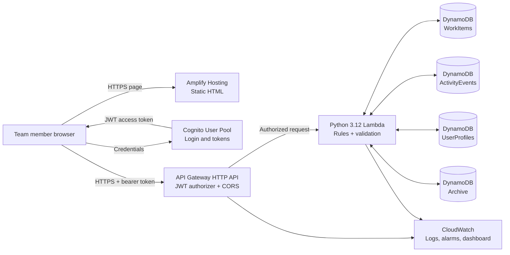
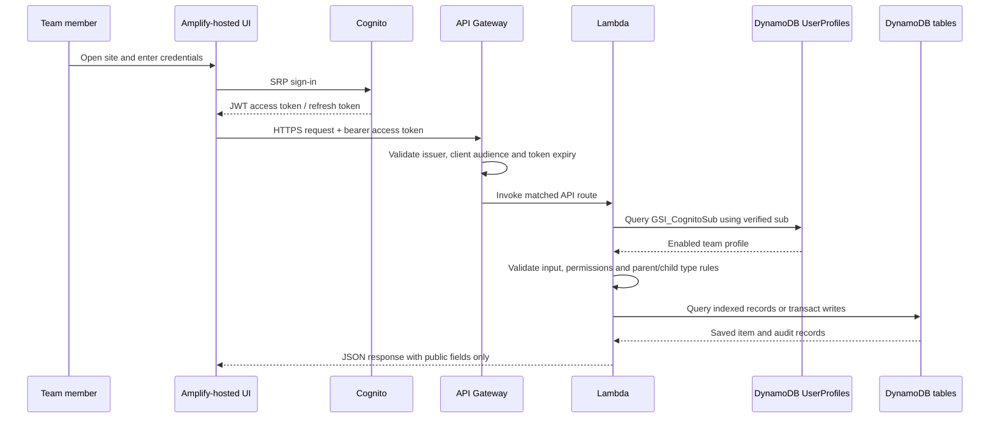

# Architecture and request flow

This document describes the intended **live AWS deployment**. It is a design and operating reference; committing the files does not create AWS resources.

## 1. At a glance

| Service | Responsibility |
|---|---|
| **Amplify Hosting** | Builds and serves the frontend. `amplify.yml` publishes only `dist/`; `scripts/build.mjs` injects public runtime configuration. |
| **Amazon Cognito** | Authenticates users and issues JWTs. Self-service registration is disabled; administrators assign each user a `custom:teamUserId`. |
| **API Gateway HTTP API** | Validates the JWT before forwarding a request to Lambda and allows browser calls from one explicitly configured HTTPS origin. |
| **AWS Lambda** | Enforces team-profile and hierarchy rules, derives trusted audit identity, validates input, and coordinates data writes. |
| **Amazon DynamoDB** | Shared source of truth for active items, append-only activity events, enabled team profiles, and archived items. |
| **Amazon CloudWatch** | Stores Lambda/API access logs and exposes operational metrics, alarms, and a dashboard. |

The frontend and backend have separate release steps: Amplify publishes the web app; AWS SAM deploys or updates the backend stack. A CI build uses explicitly supplied test configuration to validate the artifact; it does not deploy the SAM stack. A real Amplify release must use the actual Cognito/API outputs from the target AWS stack.

## 2. Sign-in and request sequence

API Gateway authentication is the first gate, but the Lambda handler also requires the JWT subject to map to exactly one enabled profile. A Cognito account that is not mapped, or whose profile is disabled, cannot use the application data API. User roles displayed in the UI are descriptive labels; they are not privilege levels.

## 3. DynamoDB model and access patterns

The SAM template creates four on-demand, server-side-encrypted tables. Their physical names use `<TableNamePrefix>-<suffix>`; the default prefix is `TeamFollowUp`. Use a different prefix for each environment, such as `TeamFollowUpDev` and `TeamFollowUpProd`.

| Logical table | Primary key | Secondary indexes |
|---|---|---|
| **WorkItems** | `itemId` | `GSI_ListUpdated`, `GSI_ListCreated`, `GSI_RootUpdated`, `GSI_AssignedUpdated`, `GSI_AssignedCreated` |
| **ActivityEvents** | `eventId` | `GSI_ItemTimeline`, `GSI_ApplicationTimeline`, `GSI_RootTimeline`, `GSI_ParentTimeline` |
| **UserProfiles** | `userId` | `GSI_CognitoSub` |
| **Archive** | `archiveId` | `GSI_ArchiveIndex`, `GSI_ArchiveRoot` |

The index partition/sort keys are materialized by the Lambda handler and are also described in `backend/table-schema.json`. `backend/template.yaml` is the deployable source of truth for physical resources and index definitions; the JSON file is a human-readable companion, not a second provisioning mechanism.

### Write and audit behavior

- **Create and update:** an item write and the associated activity events are written in one DynamoDB transaction. Updates use a version condition so stale edits return a conflict instead of silently overwriting a newer edit.
- **Delete/archive:** the selected item and its descendants are copied to the Archive table and removed from WorkItems in chunks. The operation records a summary activity event. If a later chunk conflicts, the handler attempts a compensating rollback and reports whether reconciliation may be needed.
- **Restore:** selected archived rows are checked for valid parents and hierarchy types before they are restored in bounded transactions. A restore summary is written after the last selected descendant in that root is saved. A conflict after earlier chunks can result in a partial restore; refresh Archive and review the response before retrying.
- **Activity history:** ActivityEvents are append-only from the application API. Indexed attributes support item, parent, root, and application-wide timelines. For an existing installation that predates the application-wide timeline index, run the migration script described in the deployment guide after the GSI is active.

## 4. Security and trust boundaries

### Browser

The web app is public client-side code. Build-time Cognito IDs, API URL, mode, and the custom attribute name are public browser configuration—not secrets. Never put AWS access keys, client secrets, or private Cognito-subject mappings into Amplify variables or frontend files.

The repository has no local authentication mode, mock data adapter, browser database, seeded workspace, or offline work-data cache. Every work item, team profile, archive record, and activity event is obtained from or written through the Cognito-authenticated API to DynamoDB. The frontend keeps a transient in-memory view of the API response only so it can render and edit the current screen; that view is not a database and is never used as a fallback source after a failed request. The build fails unless a valid Cognito User Pool ID, public app-client ID, and HTTPS API base URL are supplied.

### Authentication and API authorization

- Cognito's browser client has no client secret and is configured for SRP sign-in and token refresh.
- API Gateway uses the generated Cognito issuer and client audience as a JWT authorizer.
- CORS is limited to the exact HTTPS origin supplied as the SAM `AllowedOrigin` parameter. If the Amplify or custom domain changes, update the parameter and redeploy the backend.
- Lambda treats Cognito `sub` as the authenticated identity and resolves it through `UserProfiles.GSI_CognitoSub`. User-entered creator/editor IDs, timestamps, index fields, and version values are not trusted.
- The Lambda's DynamoDB role is read-only by default. Write operations are restricted to named transactional writes on WorkItems, ActivityEvents, and Archive, plus the ActivityEvents batch-write recovery path for a partially completed restore.

### Data protection

- DynamoDB tables and the Cognito User Pool are retained if the CloudFormation stack is removed or an update replaces a resource. **Retain does not mean backup or recovery is automatic**; point-in-time recovery is enabled by default and should be checked after deployment.
- Lambda returns generic errors to clients. Request IDs, error types, and database error codes are logged for operators, but request bodies and authorization headers are intentionally excluded from access logs.
- Deployment scripts are administrative tools. Run them from a trusted workstation or controlled CI job using short-lived AWS credentials and the minimum IAM actions documented in the deployment guide.

## 5. Monitoring and operating model

The stack creates log groups with configurable retention, a CloudWatch dashboard, and alarms for Lambda errors, Lambda throttles, and API Gateway 5xx responses. Alarm actions are not configured by default, so email or paging requires an SNS topic/subscription and explicit alarm actions.

Monitor both Lambda logs and API Gateway access logs. The dashboard reports request volume, 5xx responses, Lambda duration, errors, and throttling. DynamoDB uses on-demand billing; point-in-time recovery, log ingestion/retention, and Cognito features can add costs. Check the current price for the selected Region before production use.

## 6. Deployment boundary

- **Frontend release:** Amplify connects to the repository branch and publishes `dist/` using `amplify.yml`.
- **Backend release:** run checks, `sam validate --lint`, and `sam build`, then deploy the packaged template with `sam deploy`.
- **Identity bootstrap:** create the six Cognito accounts, assign `custom:teamUserId` values `u1`–`u6`, and seed UserProfiles from the actual Cognito subjects.
- **Go-live:** configure Amplify with `TEAM_FOLLOW_UP_COGNITO_USER_POOL_ID`, `TEAM_FOLLOW_UP_COGNITO_CLIENT_ID`, `TEAM_FOLLOW_UP_API_BASE_URL`, and optionally `TEAM_FOLLOW_UP_COGNITO_TEAM_USER_ATTRIBUTE=custom:teamUserId`; then complete the smoke-test checklist.

For the ordered console steps, exact commands, environment variables, migration instructions, rollback cautions, and troubleshooting, follow [DEPLOYMENT.md](DEPLOYMENT.md).
