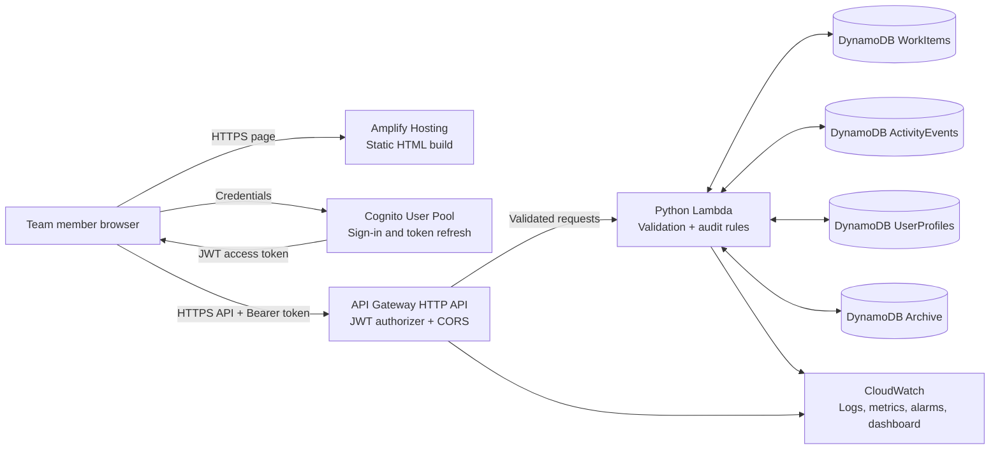
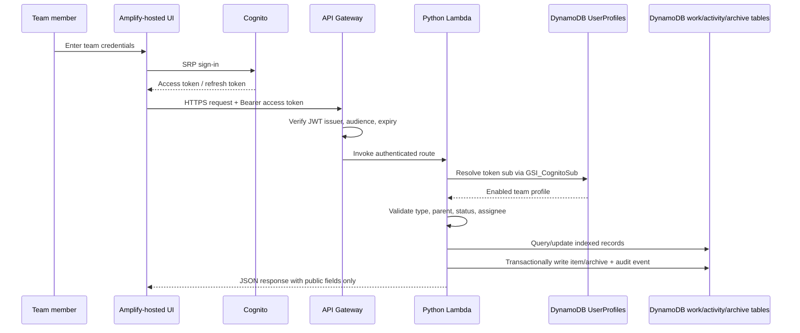

# Team Follow-Up — Deployment Architecture

## Component diagram

## Authentication and request sequence

## Responsibilities and trust boundaries

- **Amplify Hosting** is a static frontend deployment. Build-time environment variables are public browser configuration, not a place for AWS access keys or application secrets.
- **Cognito** authenticates people but does not define application permissions beyond sign-in. `custom:teamUserId` links a user to one of the configured team IDs; the browser client is not allowed to write this attribute.
- **API Gateway** verifies Cognito JWTs before the Lambda invocation and enforces the configured single-origin CORS policy.
- **Lambda** is the authorization boundary for application data. It maps the verified Cognito `sub` to an enabled profile, derives creator/editor/activity identity from that profile, validates hierarchy rules, strips DynamoDB index attributes from public responses, and returns generic messages for unexpected errors.
- **DynamoDB** is the shared source of truth. Item writes and their corresponding audit events are transactional. Activity history is append-only; archive records preserve hierarchy metadata needed for safe restoration.
- **CloudWatch** stores structured Lambda logs and API access logs, and provides request/error/throttle monitoring. Alarms are created without notification actions; add SNS actions after deployment if the team needs email or paging alerts.

## Data access patterns

| Table | Primary key | Index/query responsibility |
|---|---|---|
| WorkItems | `itemId` | `GSI_ListUpdated`, `GSI_ListCreated`, `GSI_RootUpdated`, `GSI_AssignedUpdated`, `GSI_AssignedCreated` |
| ActivityEvents | `eventId` | `GSI_ItemTimeline`, `GSI_ApplicationTimeline`, `GSI_RootTimeline`, `GSI_ParentTimeline` |
| UserProfiles | `userId` | `GSI_CognitoSub` resolves the authenticated identity |
| Archive | `archiveId` | `GSI_ArchiveIndex`, `GSI_ArchiveRoot` |

All tables use on-demand billing and server-side encryption; point-in-time recovery is enabled by default. WorkItems, ActivityEvents, UserProfiles, Archive, and the Cognito User Pool have retention protection so removing the SAM stack does not automatically erase team data/accounts.

## Deployment boundary

This repository provisions resources through the SAM/CloudFormation template and publishes the UI with Amplify Hosting. No live resources are created just by running `npm run build` or the test suite. Follow [DEPLOYMENT.md](DEPLOYMENT.md) for stack parameters, account seeding, Amplify environment variables, post-deployment verification, and recovery precautions.
