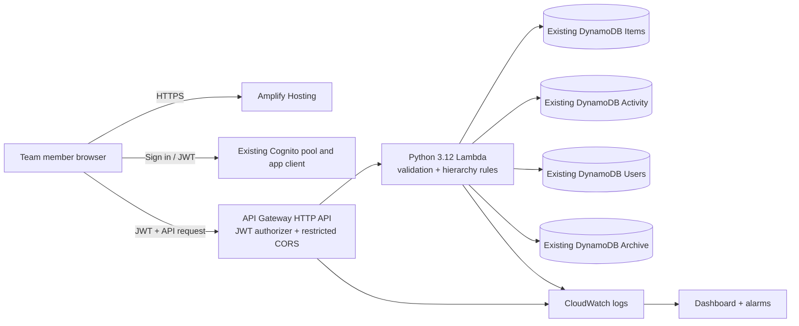

# Architecture and request flow

This document distinguishes AWS resources already created manually from the backend resources that will be deployed by AWS SAM later.

## 1. Current AWS state

- **Region:** US East (N. Virginia), `us-east-1`.
- **Cognito:** existing pool `us-east-1_7dYZw2Is6`, app client `7id8c2g27fvbh365atqntqurir`; email sign-in, self-registration disabled, MFA off. The operator confirmed `custom:teamUserId` was added, Read enabled, and Write disabled for `Team_FollowUp` on 15 October 2026; permissions on other app clients remain to be verified.
- **DynamoDB:** four manually created Standard tables with provisioned 1 RCU / 1 WCU per base table and per GSI. Three Items GSIs plus two Archive GSIs means **9 RCUs and 9 WCUs** configured.
- **Not yet deployed:** Amplify Hosting, API Gateway, Lambda, CloudWatch log groups/dashboard/alarms, Cognito hosted-login domain and callback URLs, team Cognito accounts, and their Users-table mappings.
- **Budget:** `TeamFollowUp-Monthly-Cost`, USD $1/month, with actual 50/80/100% and forecast 100% alerts. This is a notification budget, not a spend cap.

## 2. Target deployment, reusing existing data resources

The frontend and backend have separate release steps. API Gateway verifies the JWT against the existing Cognito pool and app-client audience. Lambda then resolves the verified Cognito `sub` to exactly one enabled team profile before reading or changing application data. User-entered creator/editor IDs, timestamps, index keys, and version values are not trusted.

**SAM owns only the API Gateway HTTP API, Lambda, scoped IAM policies, CloudWatch log groups, dashboard, and alarms.** Its parameters point to the existing pool/client and four table names. It does not create, import, replace, or manage the existing Cognito or DynamoDB data resources. Removing the backend stack will not delete those manually created resources.

## 3. Existing DynamoDB model and access patterns

| Table | Primary key | Existing indexes / Lambda access |
|---|---|---|
| `TeamFollowUp-Items` | Partition `itemId` (String) | `ParentIdIndex`: `parentId` / `createdAt`; `AssignedToIndex`: `assignedTo` / `updatedAt`; `WorkspaceIndex`: `workspaceKey` / `createdAt` |
| `TeamFollowUp-Activity` | Partition `itemId` (String), sort `activityKey` (String) | No GSIs. Item history uses Query on `itemId`; application-wide history uses Scan. |
| `TeamFollowUp-Users` | Partition `userId` (String) | No GSIs. Cognito-subject lookup scans this deliberately small six-member table and fails closed on missing, duplicate, or disabled mappings. |
| `TeamFollowUp-Archive` | Partition `archiveId` (String) | `GSI_ArchiveIndex`: `archivePK` / `archiveSort`; `GSI_ArchiveRoot`: `archiveRootPK` / `archiveRootSort`. Both use All projection. |

All four base tables and all five GSIs are provisioned at 1 RCU / 1 WCU each. Auto scaling, point-in-time recovery, deletion protection, and DynamoDB Streams are disabled.

### Materialized item attributes

- Project/job records receive `workspaceKey=WORKSPACE` so top-level items use `WorkspaceIndex`.
- Child records retain `parentId`, which drives `ParentIdIndex`.
- The API keeps `ownerId` as the frontend/business field and copies it to `assignedTo` for `AssignedToIndex`.
- Filtered results are sorted by the requested creation/update timestamp after retrieval through the matching current index.

### Activity key and performance trade-off

Activity is **not** an eventId-keyed table. Every event is stored under `itemId` and `activityKey = ISO timestamp + "#" + eventId`; `eventId` remains a regular attribute for the UI. Per-item timelines are queried directly by partition key. Since the existing Activity table has no GSIs, application-wide activity history deliberately scans the table. This avoids adding index capacity now, but scan time and read-capacity consumption grow with the history table. Do not run the legacy ActivityEvents index-migration script against `TeamFollowUp-Activity`.

## 4. Transaction, archive, and audit behavior

- **Create/update:** item writes and their audit-event writes share a DynamoDB transaction. Updates use a version condition to detect stale edits.
- **Delete/archive:** the selected item and descendants are copied to Archive and then removed from Items in bounded transactions. Parent/root snapshots are preserved, and a summary activity event records the archive operation. If a later transaction fails, the handler attempts compensating rollback and reports if reconciliation may be needed.
- **Restore:** selected archived rows are checked for valid parent/child types before being returned to Items. Restore summaries are committed with the last selected item for a hierarchy where possible. A conflict after earlier chunks can result in a partial restore; refresh Archive and inspect the returned restored IDs before retrying.
- **Activity history:** events are append-only through the API. Item history is read by item partition; global activity is read by a full-table scan on the existing Activity table.

## 5. Security boundaries

- API Gateway uses the existing Cognito pool issuer and app-client ID as JWT audience. CORS permits only the exact HTTPS `AllowedOrigin` supplied at deployment.
- Lambda treats Cognito `sub` as the authenticated identity and scans `TeamFollowUp-Users` for the corresponding `cognitoSub`. It denies unknown, duplicate, or disabled mappings.
- Lambda read permissions are scoped to the four configured tables and their indexes. Transactional writes are scoped to Items, Activity, and Archive. Direct batch-write permission exists only for partial-restore activity summaries on Activity.
- The `custom:teamUserId` attribute was added according to operator confirmation, and the operator confirmed Read is enabled and Write is disabled for `Team_FollowUp`. Before creating/inviting team accounts, verify that **every other** app client in the pool is also denied Write permission. The frontend uses this claim to resolve the signed-in team identity; only trusted administration should set or correct its value.
- The frontend receives only public Cognito IDs, API URL, and custom-attribute name. Never put AWS access keys, client secrets, or private Cognito subject values in frontend files or Amplify environment variables.

## 6. Monitoring, recovery, and cost

SAM adds CloudWatch log groups, a dashboard, and alarms for Lambda errors/throttles and API Gateway 5xx responses. Alarm notification actions are not configured by default. The budget created in AWS notifies by email but does not stop spend.

All existing DynamoDB tables have point-in-time recovery disabled. Activity and Users scans are reasonable for the current small lab, but their latency/cost grows with table size. Retention settings on newly created backend resources do not constitute backups of pre-existing tables. Check account credits and current regional pricing before changing capacity or adding GSIs, backups, hosted services, or monitoring.

## 7. Deployment boundary

1. Verify the existing Cognito pool/client settings and the `custom:teamUserId` Read/Write permissions, then create the unique team account mappings and confirm all required index statuses.
2. Create Amplify Hosting and record the final HTTPS origin.
3. Build and deploy the SAM backend with the existing pool/client/table-name parameters and that `AllowedOrigin`. Review the change set to confirm no Cognito pool or DynamoDB table is being created.
4. Set Amplify environment variables using the existing Cognito IDs and the deployed API output.
5. Test sign-in, cross-session shared data, item hierarchy validation, activity history, archive/restore, unauthorized requests, and CloudWatch alarms.

The schema reference in `backend/table-schema.json` and the contract tests intentionally encode the current table keys and index names so later code changes cannot silently drift back to the abandoned table design. See [IMPLEMENTATION.md](IMPLEMENTATION.md) for the exact bootstrap record and [DEPLOYMENT.md](DEPLOYMENT.md) for commands.
