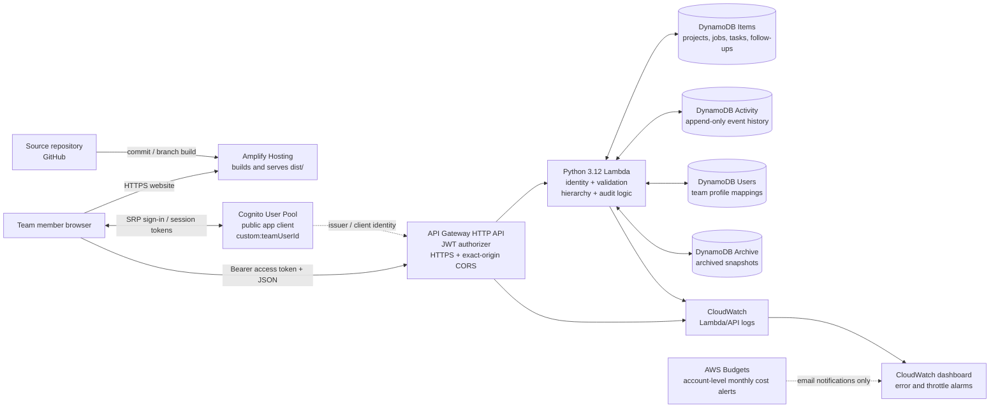

# Architecture reference

**Purpose:** reference the complete Team Follow-Up target architecture, its trust boundaries, data model, monitoring and resource-creation approaches. This is a target-state design, not an assertion that every resource has already been created in the AWS account.

**Primary deployment method:** create and configure AWS resources manually in the AWS Management Console. The optional full-stack CloudFormation/SAM template in `backend/template.yaml` is retained as an automation/reference method; it creates resources from scratch and does not expect pre-existing Cognito or DynamoDB resources.

## 1. Complete target architecture

All regional application services are intended to run in **US East (N. Virginia), `us-east-1`**. AWS Budgets is an account-level billing monitor and is drawn separately in the diagram; its notifications are not a spending cap.

### Request and trust boundaries

1. **Frontend delivery:** GitHub contains the source. Amplify Hosting checks out the selected branch, uses `amplify.yml` with Node.js 24 to run `scripts/build.mjs`, then publishes `dist/`. Public runtime settings are injected at build time; no AWS credentials or private account mappings are included in the browser artifact.
2. **Authentication:** the frontend signs in directly against Cognito using the SRP flow and keeps the resulting session in the browser auth SDK. The current app does not use Cognito managed login/hosted UI, so a hosted-login domain or OAuth callback URL is not required.
3. **API edge:** the browser sends an access token as `Authorization: Bearer ...`. API Gateway's JWT authorizer validates the token signature, issuer and app-client audience. CORS permits the exact Amplify branch HTTPS origin, the `Authorization` and `content-type` request headers, and the methods the client uses.
4. **Application logic:** Lambda resolves the verified token's Cognito `sub` to exactly one enabled `TeamFollowUp-Users` profile by matching `cognitoSub`. It does not trust browser-supplied creator/editor identity, timestamps, index helper attributes, or version numbers.
5. **Shared persistence:** Lambda performs reads and writes against the four DynamoDB tables. Item changes and audit events use transactions where supported; hierarchy rules are enforced in Lambda because DynamoDB does not implement relational foreign keys.
6. **Operations:** API access and Lambda logs use CloudWatch. A dashboard summarizes request volume, Lambda invocations/errors/throttles and duration; alarms detect Lambda errors, Lambda throttles and API Gateway 5xx responses. AWS Budgets sends actual and forecast cost warning emails independently of application traffic.

## 2. Component and ownership reference

| Component | Purpose and target configuration | Console-first creation | Optional template resource |
|---|---|---|---|
| GitHub repository | Source control and reviewed changes; target branch is configurable, default `main`. | Connect repository to Amplify. | Repository URL and a private GitHub access token are deployment-time parameters to `AWS::Amplify::App`. |
| Amplify Hosting | Static frontend build and HTTPS distribution. | Create a Hosting app/branch and set public build variables. | `FrontendApp` + `FrontendBranch`; environment variables reference the pool, client and API outputs. |
| Cognito User Pool | Email-based sign-in, administrator-created users only, MFA off, mutable String custom attribute `teamUserId` (length 1–32). | Create a pool and its schema in Cognito. | `TeamFollowUpUserPool`. |
| Cognito app client | Public browser client with no secret; supports SRP and refresh; can read but cannot write `custom:teamUserId`. | Create `Team_FollowUp` and set attribute permissions. | `TeamFollowUpAppClient`. |
| DynamoDB Items | Active Projects, Jobs, Tasks and Follow-ups. Partition key `itemId`; GSIs `ParentIdIndex`, `AssignedToIndex`, `WorkspaceIndex`. | Create table and three indexes. | `ItemsTable`. |
| DynamoDB Activity | Activity history. Partition key `itemId`, sort key `activityKey`; no GSIs. | Create table with composite key only. | `ActivityTable`. |
| DynamoDB Users | Team profile and Cognito subject mapping. Partition key `userId`; no GSIs. | Create table; seed profiles after Cognito accounts exist. | `UsersTable`. |
| DynamoDB Archive | Archived copies/hierarchy metadata. Partition key `archiveId`; GSIs `GSI_ArchiveIndex`, `GSI_ArchiveRoot`. | Create table and two indexes. | `ArchiveTable`. |
| API Gateway HTTP API | Authenticated JSON endpoints, Cognito JWT authorizer, access logs and CORS. | Create API, Lambda integration, route and authorizer in the console. | `TeamFollowUpApi` with the same JWT/CORS contract. |
| Lambda | Python 3.12 handler, 256 MB, 20-second timeout, structured JSON logs. | Create execution role/policy, package `backend/src`, upload ZIP and configure four table names. | `ApiExecutionRole` plus `ApiFunction`; the role uses the same default name, AWSLambdaBasicExecutionRole managed policy, and four-statement table-scoped DynamoDB policy as the console workflow. |
| CloudWatch | 30-day API/Lambda access logs, dashboard, Lambda error/throttle alarms, API 5xx alarm. | Create log groups, dashboard and alarms. | Log groups, `TeamFollowUpDashboard` and three alarms. |
| AWS Budgets | USD $1 monthly cost budget; actual thresholds at 50%, 80%, 100%, plus forecast 100%; email notifications only. | Create budget and enter the notification email. | `MonthlyCostBudget`; recipient is a deployment parameter, not committed. |

The console procedure and the template should create the same logical service set, table/index names and low-capacity data settings. AWS-generated identifiers (Cognito pool ID, app-client ID, API ID and Amplify app ID) will naturally differ between deployments.

### Frontend request lifecycle and responsiveness

The AWS frontend is a statically hosted client that keeps transient view state and a namespaced, versioned cache of successful API responses. The cache is not an alternate source of truth: requests are revalidated against the authenticated API, and writes are committed through the API/Lambda transaction path. There is no offline work-item database or queue of writes to synchronize later.

The client uses progressive loading. Bootstrap retrieves enabled team profiles and top-level Projects/Jobs; it then hydrates the selected root's children. Selecting another root loads that root's children and root-scoped Activity. A descendant history popup reuses the root Activity cache where available, while application-wide Activity is fetched only when its popup opens and is paged as the user scrolls or searches. The Activity table itself has no GSI, so a global timeline query uses Scan by design; this backend access pattern is unchanged by the frontend changes.

For responsiveness and correctness, modal clicks are handled once at the modal root, whole-subtree traversal is iterative and cycle-safe, modal type checks inspect direct children when possible, and child date comparisons use per-item Activity index entries. These are client-side code changes. They do not add or change API routes, JSON contracts, Cognito claims, DynamoDB table/index definitions, Lambda permissions, or runtime configuration.

A normal frontend-only source update is published by rebuilding the static artifact through the existing Amplify branch. It does not require a SAM/CloudFormation stack update or a Lambda ZIP replacement. Backend/infrastructure changes continue to follow the deployment method selected for that environment.

## 3. DynamoDB physical schema and access patterns

The four tables use the DynamoDB **Standard** table class, **Provisioned** billing, and **1 RCU / 1 WCU** for every base table and GSI. The target is **9 RCUs and 9 WCUs** across four base tables and five GSIs. Auto scaling, point-in-time recovery, deletion protection and Streams are off in the low-cost baseline. DynamoDB encryption at rest uses the AWS-owned default key.

| Table | Key schema | Indexes | Runtime access |
|---|---|---|---|
| `TeamFollowUp-Items` | Partition `itemId` (String) | `ParentIdIndex`: `parentId` / `createdAt`; `AssignedToIndex`: `assignedTo` / `updatedAt`; `WorkspaceIndex`: `workspaceKey` / `createdAt`. All projection. | Workspace, children and assigned-to queries. `ownerId` is the UI/business field; the API maintains `assignedTo` for the index. Top-level Project/Job rows use `workspaceKey=WORKSPACE`. |
| `TeamFollowUp-Activity` | Partition `itemId` (String), sort `activityKey` (String) | None | `activityKey = ISO timestamp + "#" + eventId`. Single-item history uses Query; all-activity uses Scan. `eventId` is not the table key. |
| `TeamFollowUp-Users` | Partition `userId` (String) | None | Lambda scans this small team table to resolve the JWT `sub` against `cognitoSub`. Missing, duplicate or disabled mappings are denied. |
| `TeamFollowUp-Archive` | Partition `archiveId` (String) | `GSI_ArchiveIndex`: `archivePK` / `archiveSort`; `GSI_ArchiveRoot`: `archiveRootPK` / `archiveRootSort`. All projection. | Archived hierarchy listings and restore. |

The schema reference is [`backend/table-schema.json`](../backend/table-schema.json), and the handler's current index names are checked by `scripts/test-infrastructure.py`. Activity/Users scans are intentional in the current small-team design; their cost and latency grow with table size. Do not run the legacy `migrate_activity_application_index.py` script against this table contract.

### Transaction, archive and audit rules

- Item creation/update writes item data and its activity event together in a DynamoDB transaction. Update versions reject stale writes.
- Archiving copies selected items and descendants to Archive and removes them from Items in bounded transactional batches; the handler attempts compensating recovery on failure.
- Restore validates parent/child type rules before reinserting records. A restore may partially succeed if a later chunk conflicts; inspect returned IDs and refresh Archive before retrying.
- Activity events are maintained by the application API. The Lambda's IAM policy allows table-scoped reads, transaction-scoped writes to Items/Activity/Archive, and Activity-only batch writes for partial-restore summary events.

## 4. Identity and security model

- **Public client boundary:** the browser app client has no client secret. It may read `custom:teamUserId`, but its writable attribute list excludes that attribute. Trusted administration assigns each account a unique team ID.
- **Two-way identity mapping:** Cognito `custom:teamUserId` identifies the frontend team profile; the ID token/access-token `sub` is mapped to the same enabled Users-table row via `cognitoSub`. Both mappings must agree.
- **No privilege by role label:** `role` values (Team Leader/AWS Engineer) are descriptive only. Authorization comes from a valid Cognito session and enabled team profile, not from role labels.
- **Minimum Lambda access:** Lambda does not receive Cognito administration privileges. The execution policy is scoped to application tables and the indexes it uses; it does not grant broad DynamoDB CRUD actions.
- **CORS is not authentication:** exact-origin CORS is configured for the branch HTTPS URL, but all data routes must still use the JWT authorizer. Never remove the authorization boundary as a CORS workaround.
- **No secrets in source:** Cognito IDs, the API URL, and the team-attribute name are public build-time settings. Do not put AWS access keys, GitHub tokens, passwords, a client secret, real `cognitoSub` values, or billing email addresses in committed files.

## 5. Monitoring, cost and recovery

- API Gateway and Lambda log groups retain logs for 30 days in the target configuration.
- Dashboard metrics include Lambda invocations/errors/throttles/duration and API count/5xx responses. The three alarms report on Lambda errors, Lambda throttles and API Gateway 5xx responses. Email/SNS alarm actions are not configured by default.
- The $1 monthly AWS Budget sends warning emails; it does **not** stop resources or cap spend. Costs can exceed the budget between alert evaluations.
- Point-in-time recovery and Streams are off on the baseline DynamoDB tables. Export/back up important data before schema changes or destructive operations.
- The optional automation template sets `DeletionPolicy: Retain` and `UpdateReplacePolicy: Retain` on DynamoDB tables. Deleting its CloudFormation stack retains the table data; a fresh stack cannot recreate the same named tables until the retained tables have been deliberately handled. Review all changesets before deployment or deletion.

Provisioned-capacity values are deliberately small for the current learning workload; they may throttle even a modest spike. Always confirm current account credits, free-plan status and regional prices before increasing capacity or enabling optional features.

## 6. Deployment and source-of-truth rules

### Primary: AWS Management Console

The intended project workflow is to create/configure AWS resources manually in the console, record generated identifiers privately, and deploy/update each service with the matching console workflow. [`docs/DEPLOYMENT.md`](DEPLOYMENT.md) is the primary runbook; [`docs/IMPLEMENTATION.md`](IMPLEMENTATION.md) is a dated record of the AWS resources reported as already created in the current account. If the live account state changes, update that implementation record separately from this target architecture.

### Optional automation reference: CloudFormation/SAM

The end-to-end optional automation procedure is documented in [`AUTOMATED_DEPLOYMENT.md`](AUTOMATED_DEPLOYMENT.md). [`backend/template.yaml`](../backend/template.yaml) is a **full-stack, from-scratch template**. It creates a Cognito pool and public client, four DynamoDB tables/indexes, API Gateway, Lambda/IAM, CloudWatch logs/dashboard/alarms, an Amplify Hosting app/branch and the $1 monthly Budget. It does not accept IDs or names of pre-existing data resources. At the default prefix, it uses the same DynamoDB names and schema as the console runbook.

This template is **not** the planned day-to-day deployment method. Run `sam validate` and `sam build` for optional validation/build checks; do not run `sam deploy` as part of the console-first workflow. To exercise the automation alternative, use a fresh environment or deliberately choose a different resource prefix. Do not deploy it on top of the current console-created pool/tables/budget: CloudFormation does not automatically adopt them, and duplicate physical names will fail. The template needs deployment-time GitHub repository access and a budget-alert email; neither value belongs in Git. The template creates the exact branch HTTPS origin for CORS from Amplify's generated domain and injects the generated API URL into the branch configuration.

## 7. Current-account checkpoint

This architecture deliberately describes the complete target regardless of which resources currently exist. The dated [implementation record](IMPLEMENTATION.md) states that the user's `us-east-1` account has already had a Cognito pool/client, the four DynamoDB tables and the $1 monthly budget created manually; Amplify Hosting, API Gateway/Lambda and CloudWatch observability were still pending in that record. Those facts describe the current account snapshot, not requirements that other environments or the full-stack template may assume.
